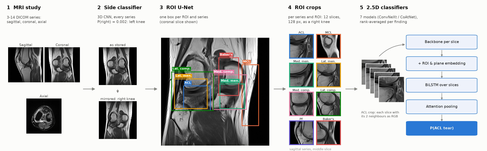

# RSNA Knee Abnormality Detection - ROI-based Pipeline

**Author:** Theo Viel

This repo contains a simplified version of the ROI-based pipeline used in the Kaggle RSNA Knee Abnormality Detection competition.
It handles 8 of the 12 classes of the challenge, and can be extended to other classes although it is slightly less competitive on these findings.

## Competition Overview

The [RSNA Knee Abnormality Detection](https://www.kaggle.com/competitions/rsna-knee-abnormality-detection) challenge asks for the probability of 12 findings per knee MRI study, scored by the macro AUC over the 12. A study holds 3 to 14 DICOM series (sagittal, coronal and axial; T1, PD or T2, with or without fat suppression) from a mix of international sites, scanners and protocols. Submissions are Kaggle notebooks without internet access, run on about 1,300 test studies.

| Group | Findings |
|---|---|
| Ligaments | ACL, MCL |
| Menisci | Medial meniscus, lateral meniscus |
| Osteoarthritis | Medial, lateral and patellofemoral (PF) compartments |
| Joint | Effusion, synovitis, Baker's cyst |
| Bone | Contusion, fracture |

**Labels are the main difficulty:**
- **Only 58 of the 4,407 training studies have radiologist labels.** All the others come with their radiology report only: free text, in several languages, absent at test time.
- **The report labels are noisy.** Here they were extracted by LLMs (Claude, Codex) as soft labels. Against the 58 radiologist labels, Claude's labels score 0.911 macro AUC and the mean of both sets 0.921 (on the 52 studies Codex covers): that is about the ceiling of a model trained on them. The two sets disagree most on what counts as positive, e.g. Codex calls 31% of the studies a Baker's cyst, Claude 13%.
- **The 58 studies are too few to select models on.** With 9 to 35 positives per finding, one finding's AUC moves by several points between equivalent models. A 10% holdout of report-labelled studies serves for model selection instead.
- **No localisation is provided.** Every finding sits in a specific structure (a ligament, a meniscus, a compartment), but there are no boxes or masks, and the knee side is not always tagged. This pipeline learns both: the ROIs from the classifier's attention, the side from the DICOM tags.


## Pipeline



*A left knee from the training set. Its coronal series is mirrored to a right knee, the U-Net puts one box per ROI on every sagittal and coronal series, and each ROI's 12-slice crop goes through the 2.5D classifiers.*

1. **Data.** DICOM to raw arrays sorted along the slice normal (`prepare_data.py`). Then a uint8 cache: per-series percentile normalisation, padded square, 384 px, at most 64 slices (`prepare_cache.py`).
2. **Knee side** (`side_cls.py`, `main_side.py`). A small 3D CNN predicts left or right for every series, since a study can hold both knees. It is trained on the DICOM Laterality tag, which is wrong on about 1–2% of tagged series; the model's prediction is the side used everywhere after this step.
3. **Classifier with attention** (`main_cls.py`, `knee_cls/`). A 2.5D ConvNeXt on whole series, for the 12 findings, trained on the Claude report labels.
   - Per finding, it has an in-plane attention map per frame and an attention over frames, i.e. a 3D attention volume.
   - Four variants (224 px, 10 frames, 288 px, ConvNeXt-small) give the maps that seed the ROIs.
4. **ROI localization** (`roi/`, `main_roi.py`). One box per ROI in every sagittal and coronal series, from a 3D U-Net on 32 × 128 × 128 volumes flipped to a right knee. There are no ground-truth boxes, so the labels are bootstrapped from the attention and refined over 4 rounds:

   | Round | Labels |
   |---|---|
   | 0 | Attention of the 4 classifiers, ±2 px shift TTA (`roi.extract`). A box is kept when the map is compact and the other view of the study does not contradict it (`roi.labels attention`). |
   | 1 | U-Net boxes that another series of the study confirms (patient-space IoU ≥ 0.3) replace or add labels. Medial / lateral pairs on the wrong side of the knee are dropped, and so are menisci outside their compartment. Gaps are filled by registration from the study's other series (`roi.labels merge`). |
   | 2 | As round 1, plus MCL boxes from an anatomical prior along the medial compartment (`roi.mcl_prior`): the classifier never attends to the ligament itself. Baker's boxes come from attention, kept when behind the femorotibial compartments (`roi.labels bakers`). |
   | 3 | As round 1, with MCL taken from the prior only, placed on the round-2 compartments. The round-3 U-Net is the one in the weights. |

   Label-free quality on 2,058 held-out series (`roi.evaluate`):

   | | Round 0 | Round 1 | Round 3 |
   |---|---|---|---|
   | Cross-view IoU (sagittal vs coronal, patient space) | 0.335 | 0.411 | **0.464** |
   | Same-plane IoU | 0.553 | 0.659 | **0.698** |
   | Meniscus inside its compartment (medial / lateral) | 0.64 / 0.78 | 0.84 / 0.78 | **1.00 / 1.00** |

5. **Crops** (`crops/prepare.py`). Per series and ROI: a square around the box with 25% margin, 128 px, 12 slices over the box, in right-knee orientation. Axial series get their boxes by registration from the sagittal and coronal ones (`crops/axial_boxes.py`).
6. **Crop classifiers** (`crops/train.py`, `main_crops.py`). Each slice and its two neighbours go through a timm backbone, then a BiLSTM over slices and attention pooling, with ROI and plane embeddings. Training uses soft BCE.
   - **Teachers:** 27 runs on the Claude, Codex and mean report labels, scored on a 10% holdout.
   - **Pseudo-labels:** per finding, the mean of its 5 best teachers on every study (`pl_round1`). The training targets are 0.5 × that + 0.5 × the mean of the Claude and Codex labels (`pl_round2`, `crops/pseudo_labels.py`).
   - **Students:** the 7 submission models, fullfits on `pl_round2`, where the 58 radiologist studies keep their own labels.
7. **Recipe** (`recipe.json`). Per finding, the mean rank over the test studies of its models.


Twelve findings per knee MRI study, scored by macro AUC. This branch holds the code behind `rsna-knee-weights-1`, which predicts the 8 findings that have an anatomical region:
- ACL, MCL;
- medial and lateral meniscus;
- medial, lateral and patellofemoral OA;
- Baker's cyst.

| AUC on the 58 radiologist-labelled studies | ACL | MCL | Med. men. | Lat. men. | Med. OA | Lat. OA | PF OA | Baker's | **Macro** |
|---|---|---|---|---|---|---|---|---|---|
| rsna-knee-weights-1 | 0.972 | 0.994 | 0.975 | 0.921 | 0.974 | 0.872 | 0.896 | 0.986 | **0.949** |

These are validation versions of the models: the submitted ones are fullfits that also train on these 58 studies.
On the leaderboard, with the other 4 findings from another model, the submission scored 0.962 public / 0.951 private.

## Reproducing the weights

Environment: `uv sync` (Python 3.12; `pyproject.toml` lists only what `src/` and the notebook import, plus the DICOM decoders).

From `src/`, with 4 GPUs and the competition data added to `input/` (`train.csv`, `train_series.csv`, `train_series/`); the report labels are already there.

```bash
bash reproduce.sh                  # data side cls roi crops teachers students package
bash reproduce.sh teachers         # or any stage on its own, once the earlier ones exist
```

- Every run logs to `logs/repro/<name>/<date>/<id>/`.
- The weights land in `output/weights_1/`, with the same layout as `rsna-knee-weights-1`.
- Start from an empty `output/`: some steps skip outputs that already exist (e.g. the attention maps).

**Skipping the ROI stages.** To retrain only the crop models, the original sides and boxes in `input/` replace the `side`, `cls` and `roi` stages:

```bash
bash reproduce.sh data
cp ../input/series_laterality.csv ../output/
python -m crops.prepare --boxes ../input/rois.csv.gz --name r3
python -m crops.prepare --boxes ../input/rois.csv.gz --name r3_axial --volumes volumes_axial
bash reproduce.sh teachers students    # or, without the teachers:
                                       # cp ../input/pl_round2.csv ../output/crops/ && bash reproduce.sh students
```

The `package` stage then needs the side and U-Net runs; for inference, take `side/` and `roi/` from `rsna-knee-weights-1`.

**Differences from the original runs:**
- **Side classifier labels:** the DICOM tag only. Originally, untagged studies also took the side inferred from the round-1 U-Net boxes.
- **U-Net training:** every round already flips knees to the right side. Originally rounds 0 and 1 predated this and used left-right mirroring instead.
- **Baker's maps:** one attention extraction serves round 0 and the round-2 Baker's labels, instead of a second extraction with the same 4 runs.
- **Training noise:** training is not bit-deterministic, so retrained models differ slightly from the originals.

Reproduced exactly from the original intermediate files:
- the arrays and geometry from `prepare_data.py`;
- the round-0, round-3, MCL-prior and Baker's labels;
- the `r3` training crops;
- `pl_round1` / `pl_round2` from the teachers' predictions.

## Files in `input/`

| File | Content |
|---|---|
| `input/full_claude_context_v2_labels.csv` | Claude soft labels from the reports, 12 findings, all 4,407 studies |
| `input/codex-labels_final_52.csv`, `codex-labels_final_4349.csv` | Codex soft labels from the reports: 52 of the 58 radiologist studies + the 4,349 others |
| `input/pl_round1.csv` | Pseudo-labels: per study and ROI finding, the mean of the 5 teachers |
| `input/pl_round2.csv` | The crop models' targets: 0.5 × `pl_round1` + 0.5 × the mean of the Claude and Codex labels (NaN for the 6 radiologist studies without Codex labels) |
| `input/series_laterality.csv` | Every training series: plane, DICOM Laterality tag, side classifier P(right) and side (`side_model`, the side used everywhere) |
| `input/rois.csv.gz` | Round-3 ROI boxes of every training series: U-Net boxes on sagittal / coronal series (`source` unet), registered boxes on axial ones (`source` registered). Original voxel indices (`z0`..`x1`, inclusive; slices in the order of `prepare_data.py`) and the box confidence |

## Inference

`notebooks/inference.ipynb` runs `src/infer/pipeline.py` on Kaggle (2 × T4) with the `rsna-knee-code`, `rsna-knee-wheels` and `rsna-knee-weights-1` datasets. It makes one streaming pass per GPU; only DICOM reading runs on the CPU.
- **Input normalisation first** (`infer/sanitize.py`): compressed, multi-frame, RGB, duplicated-slice and spacing-less series are rewritten as plain DICOMs, and blank or abbreviated plane names are filled or normalised. A series that still fails only costs its own predictions.
- **Studies without a usable sagittal or coronal series** get the finding's median.

On 34 training studies, the pipeline reproduces the submission of the original dataset_1 inference code exactly. On the same studies with 14 kinds of corrupted DICOMs, it completes without error or missing value. Only the studies left with no usable sagittal or coronal series fall back to medians: no geometry at all, or axial series only.

## Layout

```
src/
  params.py, dicom_io.py, knee_registration.py   paths, DICOM reading rules, patient-space geometry
  prepare_data.py, prepare_cache.py              stage 1
  side_cls.py, main_side.py                      stage 2
  knee_cls/, main_cls.py                         stage 3
  roi/, main_roi.py                              stage 4
  crops/, main_crops.py                          stages 5-6
  infer/                                         inference
  reproduce.sh                                   all training stages
notebooks/inference.ipynb                        Kaggle inference
input/                                           labels, knee sides, ROI boxes of the training set (+ the competition data, not tracked)
```
